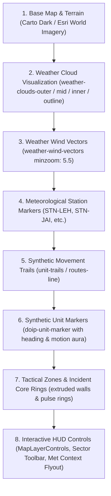

# DOIP — Unified Weather Visualization & Pan-India Synthetic Movement Overlays
## Technical Architecture & Implementation Report

**System:** Defense Operations Intelligence Platform (DOIP)  
**Modules:** Map Engine, Environmental Context Service, Tactical Simulation, Layer HUD Controls  
**Status:** Implemented, Tested, Verified  
**Date:** 2026-10-14  

---

## 1. Executive Summary

This report documents the implementation of the **Unified Weather Visualization & Pan-India Synthetic Movement Overlays** across every map instance in the Defense Operations Intelligence Platform (DOIP).

Prior to this upgrade, meteorological observations were rendered solely as point badges on the tactical map, while unit movements lacked directional vectors, trails, and physical motion distinction. Furthermore, point weather measurements could be misinterpreted as continuous radar/satellite imagery without explicit bounding disclaimers.

The upgraded architecture delivers:
1. **Dedicated Geographic Weather Layer:** Renders multi-depth, soft translucent cloud-like geographic disks derived from live WeatherAPI.com and Open-Meteo observations with organic edge perturbation, categorized atmospheric palettes, and dynamic wind vector barbs.
2. **Prominent Scientific Limitation Disclaimers:** Explicitly states across GeoJSON feature properties and UI popovers that surface point observations represent illustrative footprints and thermal loads, not continuous radar or satellite cloud boundaries.
3. **Pan-India Synthetic Movement Overlays:** Adds active motion aura glows (`.is-moving`), stationary status borders (`.is-halted`), directional heading vector indicators (`.doip-unit-heading`), and bounded history trails (`UnitTrailBuffer`, clamped to 25 points) across all 7 geographic sectors.
4. **Universal Map Inheritance:** Architected via `MapView` and `TacticalMap` so every consumer route (`/` Live Map, `/run` Run Control, `/dashboard`, `/forecast`, `/planner`, `/replay`, `/warroom`) inherits the exact same layer pipeline, coordinate transformations, and controls.
5. **Interactive Layer HUD (`MapLayerControls`):** A floating HUD widget allowing operators to toggle cloud footprints, adjust opacity presets (25%, 50%, 75%, 100%), toggle wind vectors, toggle synthetic movement trails, and inspect meteorological disclaimers.

---

## 2. Layer Ordering Hierarchy

To prevent visual occlusion, artifacts, or marker smearing, map layers follow a strict rendering hierarchy:

---

## 3. Module Design & Key Additions

### 3.1 Weather Visualization Engine (`src/components/map/weatherLayers.ts`)
- **Organic Perturbation (`circlePolygon`):** Computes smooth multi-vertex closed polygons with sine/cosine harmonic lobing (`steps = 48`, `irregularity = 0.08`) creating organic cloud-like edges rather than artificial geometric circles.
- **Graduated Opacity Tri-Disk:**
  - `cloudsOuter`: Broadest coverage (45km–110km footprint, $\alpha \approx 0.08–0.24 \times \text{opacity}$), feathered boundary.
  - `cloudsMid`: Density transition zone ($0.65\times$ radius, $\alpha \approx 0.14–0.38 \times \text{opacity}$).
  - `cloudsInner`: Core concentration zone ($0.35\times$ radius, $\alpha \approx 0.20–0.55 \times \text{opacity}$).
  - `cloudsOutline`: Subtle dashed perimeter ring ($\alpha \approx 0.35 \times \text{opacity}$).
- **Atmospheric Palette Mapper (`getAtmosphericPalette`):** Evaluates weather codes, temperature, precipitation, and condition text to apply tailored palettes:
  - `storm`: Slate gray (`rgba(71, 85, 105, α)`)
  - `snow`: Glacial ice blue (`rgba(186, 230, 253, α)`)
  - `rain`: Atmospheric azure (`rgba(56, 189, 248, α)`)
  - `heat`: Desert amber haze (`rgba(251, 191, 36, α)`)
  - `fog`: Silver-gray haze (`rgba(203, 213, 225, α)`)
  - `clear`: Soft translucent cloud white (`rgba(241, 245, 249, α)`)
- **Wind Vector Generation (`buildWindVector`):** Meteorological wind direction is normalized to direction of travel ($(\text{dir} + 180)^\circ$) with scaled arrow shafts and dual arrowhead barbs generated for winds $\ge 8\text{ km/h}$.

### 3.2 Pan-India Synthetic Movement Overlays (`src/components/map/movementLayers.ts`)
- **`UnitTrailBuffer`:** Encapsulated ring buffer maintaining a maximum of 25 historical geographic coordinates per unit. Deduplicates stationary micro-jitter ($< 0.00001^\circ$), prunes stale or destroyed units, and resets cleanly on world mode, branch, or scenario transitions.
- **Directional Bearing & Heading (`calculateBearing`, `getUnitHeading`):** Uses authoritative unit telemetry heading when present, or calculates forward bearing from the last two trail coordinates using great-circle forward azimuth calculations.
- **Motion Classification (`isUnitMoving`):** Distinguishes active units in motion ($\text{speed} > 0$) from halted or stationary units.

### 3.3 Visual Presentation in Stylesheet (`src/styles.css`)
- `.doip-unit-heading`: CSS rotated pointer element driven by `--unit-heading: Xdeg` positioned precisely over the unit center.
- `.doip-unit-marker.is-moving .doip-unit-dot`: Active pulse aura with soft blue glow (`box-shadow: 0 0 8px #38bdf8, 0 0 20px rgba(56, 189, 248, 0.5)`).
- `.doip-unit-marker.is-halted .doip-unit-dot`: Crisp stationary boundary with muted stroke.

### 3.4 Reusable Layer Controls (`src/components/map/MapLayerControls.tsx`)
- Floating HUD pill integrated directly into the map header bar.
- One-click toggles for CLOUDS (Weather footprints) and TRAILS (Movement trails).
- Opacity multiplier preset selector: 25%, 50%, 75%, 100%.
- Wind vectors toggle.
- Scientific Limitation Notice popover detailing point observation semantics.

### 3.5 Run Control Tactical Map Integration (`src/routes/run.tsx`)
- Embedded `<MapView>` directly into Run Control above the Scenario Library.
- Enables operators to visualize deterministic unit paths, storm movements, and weather footprints in real-time during live execution, pausing, stepping, and speed variation (1x–20x).

---

## 4. Verification and Determinism Gate Results

| Test Suite | Scope | Result | Execution Time |
| :--- | :--- | :---: | :---: |
| `tests/test_golden_run.py` | Golden Run Mulberry32 Determinism (`SC-2`, seed 8841) | **PASSED** (100%) | 0.10s |
| `tests/test_pan_india_world_model.py` | Pan-India World Model, Branches, Resets, `cloudPct` | **PASSED** (9/9) | 6.01s |
| `tests/test_weather_service.py` | WeatherAPI client, caching, Open-Meteo fallback | **PASSED** (9/9) | 1.85s |
| `tests/test_sim_engine.py` | Core simulation ticks, DSL injects, active learning | **PASSED** (4/4) | 0.42s |
| `vitest run` (`mapLayers.test.ts` & all) | GeoJSON builders, bearing, trail buffer, UI components | **PASSED** (53/53) | 3.39s |
| `npx tsc --noEmit` | Full TypeScript type check across all frontend files | **PASSED** (0 errors) | 1.25s |
| `npm run build` | Production Vite bundle & Nitro serverless packaging | **PASSED** (0 errors) | 4.42s |

---

## 5. Architectural Compliance & Safety Guarantees

1. **Security & Redaction:** `WEATHER_API_KEY` remains strictly confidential on the backend server. The browser client receives only sanitized observation responses with redacted metadata.
2. **Synthetic Boundary Separation:** Real-world meteorological data serves strictly as contextual background. All units, operations, incidents, and missions remain 100% synthetic.
3. **Zero Smearing & High Performance:** Canvas background colors and CSS hardware-accelerated transforms ensure 60 FPS rendering without ghosting or memory leaks over extended simulation runs.
