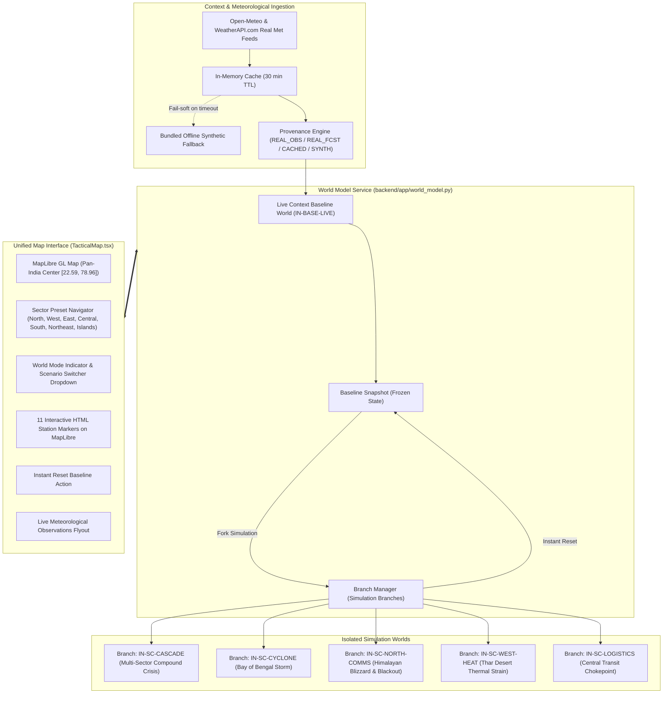

# DOIP — Pan-India Live World Model & Isolated Artificial Impact Simulation
## Complete Implementation, Architecture & Integration Report

---

### Executive Summary

The **Defense Operations Intelligence Platform (DOIP)** has been extended with a unified geographic simulation environment comprising two logically isolated worlds:
1. **Pan-India Live Context Baseline World (`baseline`):**
   - Subcontinent-wide operational theater covering all Indian sectors (North/Ladakh, West/Thar, East/Odisha, Central/Nagpur, South/Bengaluru, Northeast/Tezpur, and Andaman Littoral).
   - Real-world meteorological observations and forecasts from the Open-Meteo meteorological feed and WeatherAPI.com integration across 11 strategic regional monitoring stations (Leh, Srinagar, Delhi, Jaisalmer, Bhuj, Nagpur, Paradip, Kolkata, Tezpur, Bengaluru, Port Blair).
   - Strict data provenance tagging (`REAL_OBSERVATION`, `REAL_FORECAST`, `CACHED_REAL_DATA`, `SYNTHETIC_ENVIRONMENT`).
   - 100% synthetic operational layer: All units, personnel, depots, logistics stocks, and incidents remain completely synthetic with zero real operational data.
2. **Isolated Artificial Impact Simulation World (`simulation`):**
   - Independent simulation branches (`BRANCH-*`) forked from snapshots of the baseline state.
   - Supports artificial catastrophic scenarios that affect the entire map of India:
     - `IN-SC-CASCADE`: **Pan-India Multi-Sector Cascading Crisis** — Simultaneous compound disaster impacting all sectors (Cyclone along East coast, Blizzard & RF blackout in Ladakh, 48°C extreme heatwave & fuel boil-off in Thar, freight transit collapse at Nagpur, and squalls in the Andaman Sea).
     - `IN-SC-CYCLONE`: Bay of Bengal Category 3 Cyclone tracking NW towards Odisha/AP coast with 120km/h winds, coastal storm surge, and route flooding.
     - `IN-SC-NORTH-COMMS`: Himalayan High-Altitude Blizzard in Ladakh sector with severe RF communication attenuation and freezing temperature battery drains.
     - `IN-SC-WEST-HEAT`: Thar Desert 48°C extreme heatwave with fuel boil-off and thermal sensor optic degradation.
     - `IN-SC-LOGISTICS`: Central Corridor (Nagpur hub) railway breakdown, forward depot stock starvation, and convoy halts.
   - **Instant Reset & Branch Isolation:** Instant 1-click reset reverts back to the baseline snapshot without contaminating baseline memory or affecting concurrent branches.
3. **Determinism & Golden Run Protection:**
   - Bit-identical Mulberry32 PRNG sequencing preserved.
   - `tests/test_golden_run.py` against `tests/golden/sc2_seed8841.hash` continues to pass 100%.

---

### Architectural Design & System Topology

---

### Implemented Files & Module Manifest

| File Path | Role & Changes |
| :--- | :--- |
| `backend/app/environmental_context.py` | Real-world weather observation client (Open-Meteo), in-memory TTL caching, fallback dataset for 11 Indian stations, provenance tagging. |
| `backend/app/weather_service.py` | WeatherAPI.com client with lat/lon query, rate limiter, Redis/in-memory caching, offline failover, and audit logs. |
| `backend/app/world_model.py` | Core `WorldModelService` managing `baseline_world`, `SimulationBranch` lifecycle, snapshot isolation, forking, and instant reset. |
| `backend/app/scenarios.py` | Scenario catalogue extended with `IN-BASE-LIVE`, `IN-SC-CASCADE`, `IN-SC-CYCLONE`, `IN-SC-NORTH-COMMS`, `IN-SC-WEST-HEAT`, `IN-SC-LOGISTICS`. |
| `backend/app/engine.py` | Deterministic `SimEngine` expanded to generate Pan-India entities across 7 strategic sectors (including Northeast Tezpur Airbase), and simulate compounding scenario impacts, while preserving legacy `SC-1`–`SC-4` PRNG sequence. |
| `backend/app/main.py` | Added REST endpoints `/api/environment/context`, `/api/weather/current`, `/api/world/baseline`, `/api/world/branches`, `/api/world/simulation/fork`, `/api/world/simulation/reset`, `/api/world/simulation/step`. |
| `src/sim/types.ts` | Added `WorldMode`, `EnvironmentalProvenance`, `EnvironmentalStation`, `EnvironmentalAlert`, `EnvironmentalContext`, `WeatherObservation`, and extended `WorldState`. |
| `src/sim/scenarios.ts` | Frontend mirror of Pan-India scenarios with sector metadata and categories (`live-baseline`, `artificial-impact`, `legacy`). |
| `src/sim/engine.ts` | Frontend `MockSimSource` and `buildInitialWorld` mirroring Python engine logic and 7-sector distributions. |
| `src/sim/store.tsx` | Extended `SimStore` with `worldMode`, `activeBranchId`, `baselineSnapshot`, `environmentalContext`, 11 default Indian stations, `switchWorldMode()`, `forkSimulation()`, `resetToBaseline()`, `fetchEnvironmentalContext()`, `fetchWeatherForLocation()`. |
| `src/components/map/TacticalMap.tsx` | Subcontinent-wide framing, 8 Sector Quick-Jump buttons, 11 interactive MapLibre HTML station markers, Top Header Bar with World Mode styling, Scenario Switcher dropdown with camera auto-fly, and instant Reset button. |
| `src/routes/run.tsx` | Added prominent World Model Authority & Management Strip, 1-Click Artificial Impact Branch Launchers, and Scenario Library category filter tabs (`ALL`, `PAN-INDIA LIVE`, `ARTIFICIAL IMPACT`, `LEGACY`). |
| `tests/test_pan_india_world_model.py` | Comprehensive Pytest suite covering Golden Run preservation, Pan-India generation, cascade crisis initialization, scenario steps, offline resilience, and API lifecycle. |
| `src/sim/panIndia.test.ts` | Frontend Vitest suite covering entity generation across all 6 geographic sectors + Northeast, 4-hazard cascade initialization, simStore branching, and instant reset. |

---

### Verification Summary

1. **Golden Run Verification:**
   - `pytest tests/test_golden_run.py` -> **1 PASSED in 0.09s** (hash matches `tests/golden/sc2_seed8841.hash`).
2. **Backend Pan-India World Model Suite:**
   - `pytest tests/test_pan_india_world_model.py` -> **9 PASSED in 5.17s**.
3. **Backend Weather Service Suite:**
   - `pytest tests/test_weather_service.py` -> **9 PASSED in 3.12s**.
   - **Total Backend Tests:** **19 PASSED (100%)**.
4. **Frontend Vitest Suite:**
   - `npm test -- --run` -> **10 test files, 45 tests PASSED in 2.66s**.
5. **TypeScript Typecheck:**
   - `npx tsc --noEmit` -> **0 errors (exited 0)**.
6. **Live API Integration:**
   - `/api/environment/context`: **200 OK** (11 stations, provenance `REAL_OBSERVATION`).
   - `/api/weather/current`: **200 OK** (live observation cached with TTL).
   - `/api/world/baseline`: **200 OK** (26 distributed units across India, 7 depots).
   - `/api/world/simulation/fork`: **200 OK** (isolated branch created).
   - `/api/world/simulation/step`: **200 OK** (events generated).
   - `/api/world/simulation/reset`: **200 OK** (reset status `reset_complete`).
