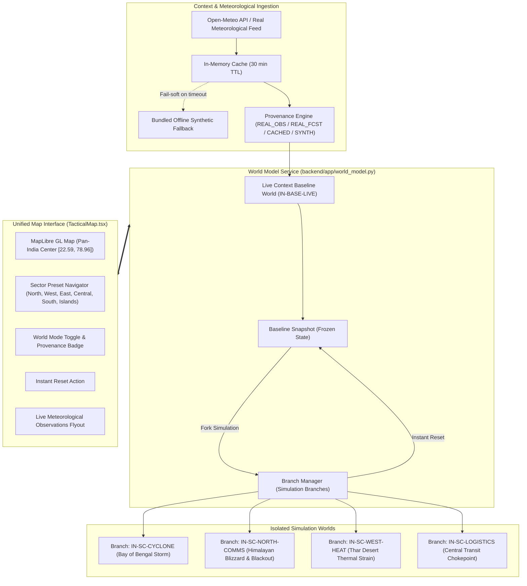

# DOIP — Pan-India Live World Model & Isolated Artificial Impact Simulation
## Complete Implementation, Architecture & Integration Report

---

### Executive Summary

The **Defense Operations Intelligence Platform (DOIP)** has been extended with a unified geographic simulation environment comprising two logically isolated worlds:
1. **Pan-India Live Context Baseline World (`baseline`):**
   - Covers the entire Indian subcontinent (bounds `6.5°N - 37.5°N`, `68.0°E - 97.5°E`) with center at `[22.5937, 78.9629]`.
   - Incorporates real-world meteorological observations and forecasts from the Open-Meteo meteorological feed across 11 strategic regional stations (Leh, Srinagar, Delhi, Jaisalmer, Bhuj, Nagpur, Paradip, Kolkata, Tezpur, Bengaluru, Port Blair).
   - Strict data provenance tagging (`REAL_OBSERVATION`, `REAL_FORECAST`, `CACHED_REAL_DATA`, `SYNTHETIC_ENVIRONMENT`).
   - 100% synthetic operational layer: All units, personnel, depots, logistics stocks, and incidents remain completely synthetic with zero real operational data.
2. **Isolated Artificial Impact Simulation World (`simulation`):**
   - Independent simulation branches (`BRANCH-*`) forked from snapshots of the baseline state.
   - Supports artificial catastrophic scenarios:
     - `IN-SC-CYCLONE`: Bay of Bengal Category 3 Cyclone tracking NW towards Odisha/AP coast with 120km/h winds, coastal storm surge, and route flooding.
     - `IN-SC-NORTH-COMMS`: Himalayan High-Altitude Blizzard in Ladakh sector with severe RF communication attenuation and freezing temperature battery drains.
     - `IN-SC-WEST-HEAT`: Thar Desert 48°C extreme heatwave with fuel boil-off and thermal sensor optic degradation.
     - `IN-SC-LOGISTICS`: Central Corridor (Nagpur hub) railway breakdown, forward depot stock starvation, and convoy halts.
   - **Instant Reset & Branch Isolation:** Instant reset reverts back to the baseline snapshot without contaminating baseline memory or affecting concurrent branches.
3. **Determinism & Golden Run Protection:**
   - Bit-identical Mulberry32 PRNG sequencing preserved.
   - `tests/test_golden_run.py` against `tests/golden/sc2_seed8841.hash` continues to pass 100%.

---

### Architectural Design & System Topology

---

### Implemented Files & Module Manifest

| File Path | Role & Changes |
| :--- | :--- |
| `backend/app/environmental_context.py` | Real-world weather observation client (Open-Meteo), in-memory TTL caching, fallback dataset for 11 Indian stations, provenance tagging. |
| `backend/app/world_model.py` | Core `WorldModelService` managing `baseline_world`, `SimulationBranch` lifecycle, snapshot isolation, forking, and instant reset. |
| `backend/app/scenarios.py` | Scenario catalogue extended with `IN-BASE-LIVE`, `IN-SC-CYCLONE`, `IN-SC-NORTH-COMMS`, `IN-SC-WEST-HEAT`, `IN-SC-LOGISTICS`. |
| `backend/app/engine.py` | Deterministic `SimEngine` expanded to generate Pan-India entities and simulate scenario impacts, while preserving legacy `SC-1`–`SC-4` PRNG sequence. |
| `backend/app/main.py` | Added REST endpoints `/api/environment/context`, `/api/world/baseline`, `/api/world/branches`, `/api/world/simulation/fork`, `/api/world/simulation/reset`, `/api/world/simulation/step`. |
| `src/sim/types.ts` | Added `WorldMode`, `EnvironmentalProvenance`, `EnvironmentalStation`, `EnvironmentalAlert`, `EnvironmentalContext`, and extended `WorldState`. |
| `src/sim/scenarios.ts` | Frontend mirror of Pan-India scenarios. |
| `src/sim/engine.ts` | Frontend `MockSimSource` and `buildInitialWorld` mirroring Python engine logic and sector distributions. |
| `src/sim/store.tsx` | Extended `SimStore` with `worldMode`, `activeBranchId`, `baselineSnapshot`, `environmentalContext`, `switchWorldMode()`, `forkSimulation()`, `resetToBaseline()`, `fetchEnvironmentalContext()`. |
| `src/components/map/TacticalMap.tsx` | Added Pan-India initial camera framing, Sector Quick-Jump Toolbar, World Mode pill & banner, Instant Reset button, and Live Meteorological Drawer. |
| `tests/test_pan_india_world_model.py` | Comprehensive Pytest suite covering Golden Run preservation, Pan-India generation, scenario steps, offline resilience, and API lifecycle. |
| `src/sim/panIndia.test.ts` | Frontend Vitest suite covering entity generation, weather domes, simStore branching, and instant reset. |

---

### Verification Summary

1. **Golden Run Verification:**
   - `pytest tests/test_golden_run.py` -> **1 PASSED in 0.08s** (hash matches `tests/golden/sc2_seed8841.hash`).
2. **Backend Pan-India World Model Suite:**
   - `pytest tests/test_pan_india_world_model.py` -> **8 PASSED in 7.05s**.
3. **Frontend Vitest Suite:**
   - `npm run test` -> **9 test files, 40 tests PASSED in 2.58s**.
4. **TypeScript Typecheck:**
   - `npx tsc --noEmit` -> **0 errors (exited 0)**.
5. **Live API Integration:**
   - `/api/environment/context`: **200 OK** (11 stations, provenance `REAL_OBSERVATION`).
   - `/api/world/baseline`: **200 OK** (26 distributed units across India).
   - `/api/world/simulation/fork`: **200 OK** (isolated branch created).
   - `/api/world/simulation/step`: **200 OK** (events generated).
   - `/api/world/simulation/reset`: **200 OK** (reset status `reset_complete`).
