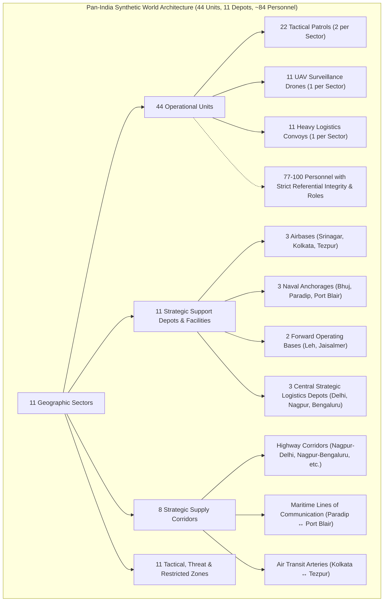

# DOIP — Full Pan-India Synthetic World Population Report
## Architecture, Data Model, Simulation Parity & Visualization Report

**Platform:** Defense Operations Intelligence Platform (DOIP)  
**Feature:** Full Pan-India Synthetic World Population & Strategic Infrastructure Overlay  
**Status:** IMPLEMENTED, INTEGRATED & VERIFIED  
**Date:** 2026-10-14  

---

## 1. Executive Summary

The **Defense Operations Intelligence Platform (DOIP)** has been extended with a comprehensive, fully populated synthetic operational world model across the entirety of India. Every weather-monitored region is now populated with coherent, internally consistent, fictional military-style units, personnel, facilities, supply routes, and tactical zones.

### Core Guarantees & Constraints Maintained
1. **100% Synthetic Domain Data:** All units, callsigns, personnel, bases, depots, supply corridors, incidents, and outcomes remain strictly fictional. Real-world geography and real-world WeatherAPI.com / Open-Meteo meteorological observations serve solely as contextual environmental backdrop.
2. **Deterministic Parity Across TypeScript & Python:** The frontend engine (`src/sim/engine.ts`) and backend simulation engine (`backend/app/engine.py`) generate bit-identical PRNG event streams and entity layouts using seeded `mulberry32`.
3. **Preservation of Legacy Golden Run (`SC-2` seed `8841`):** The legacy Golden Run hash contract (`tests/golden/sc2_seed8841.hash`) remains bit-for-bit identical (`de2edd52ed200524c77c53da3ecdeb5a92ff2694211873540efe1f681028173f`), with legacy scenarios completely isolated from pan-India generation routines.
4. **Adaptive Multi-Level Zoom Visualization:** MapLibre rendering automatically transitions between:
   - **National Overview (`zoom < 5.8`):** Aggregated Regional Cluster Badges at sector centroids displaying unit counts, personnel, support depot readiness, and real-time weather summary pills without visual clutter.
   - **Regional Operations (`5.8 <= zoom < 9.5`):** Tactical unit markers, dynamic heading arrows, active motion glow auras, movement history trails, 8 strategic supply corridors, and tactical zone boundaries.
   - **Local Tactical (`zoom >= 9.5`):** Extended unit callsigns with assigned personnel counts (`[present/total]`), depot stock levels (fuel, medkit, rations, battery), and facility type indicators.

---

## 2. Populated Strategic Sectors & Geographic Coverage

All 11 supported meteorological monitoring regions across the Indian subcontinent are populated with cohesive synthetic entities:

| Sector Code | Strategic Sector Name | Geographic Anchor | Coordinates | Facility Type & Base Name | Weather Station |
| :--- | :--- | :--- | :--- | :--- | :--- |
| `NORTH` | Northern Sector (Ladakh) | Leh / Indus Valley | 34.1526°N, 77.5771°E | `forward_operating_base`: Northern Forward Tactical Depot | `STN-LEH` |
| `KASHMIR` | Northern Sector (Kashmir Valley) | Srinagar Valley | 34.0837°N, 74.7973°E | `airbase`: Kashmir Valley Logistics & Air Support Hub | `STN-SRINAGAR` |
| `NCR` | Northern Sector (NCR / Plains) | Delhi Capital Grid | 28.6139°N, 77.2090°E | `depot`: NCR Strategic Logistics & Radar Facility | `STN-DELHI` |
| `WEST` | Western Sector (Rajasthan / Thar) | Jaisalmer Frontier | 26.9157°N, 70.9083°E | `forward_operating_base`: Western Desert Tactical Logistics Depot | `STN-JAISALMER` |
| `KUTCH` | Western Sector (Gujarat / Kutch) | Bhuj Coastal Basin | 23.2420°N, 69.6669°E | `naval_anchorage`: Kutch Littoral & Maritime Support Depot | `STN-BHUJ` |
| `CENTRAL` | Central Sector (Nagpur Corridor) | Nagpur Transit Node | 21.1458°N, 79.0882°E | `depot`: Central Logistics Transit Hub | `STN-NAGPUR` |
| `EAST` | Eastern Sector (Odisha Coast) | Paradip Maritime Hub | 20.3160°N, 86.6110°E | `naval_anchorage`: Bay of Bengal Naval & Rescue Depot | `STN-PARADIP` |
| `BENGAL` | Eastern Sector (West Bengal / Delta) | Kolkata Deltaic Hub | 22.5726°N, 88.3639°E | `airbase`: Eastern Command Air & Logistics Depot | `STN-KOLKATA` |
| `NORTHEAST`| North-Eastern Sector (Brahmaputra) | Tezpur Frontier | 26.6338°N, 92.7926°E | `airbase`: Brahmaputra Valley Frontier Airbase Depot | `STN-TEZPUR` |
| `SOUTH` | Southern Sector (Bengaluru Plateau) | Bengaluru Plateau | 12.9716°N, 77.5946°E | `depot`: Southern Command Headquarters Depot | `STN-BENGALURU` |
| `LITTORAL` | Littoral & Island Sector (Andaman) | Port Blair Island Station | 11.6234°N, 92.7265°E | `naval_anchorage`: Port Blair Maritime Support Depot | `STN-PORTBLAIR` |

---

## 3. Synthetic World Population Composition

Across the baseline world model (`IN-BASE-LIVE`) and all derived artificial impact simulation worlds (`IN-SC-CYCLONE`, `IN-SC-NORTH-COMMS`, `IN-SC-WEST-HEAT`, `IN-SC-LOGISTICS`, `IN-SC-CASCADE`):



### 3.1 Unit Structure & Callsign Conventions
- **Tactical Patrols (`22` units, 2 per sector):**
  - Callsign format: `PATROL-<SECTOR>-ALPHA` and `PATROL-<SECTOR>-BRAVO`
  - Formation size: 2 to 3 personnel (Squad Leader, Scout, Combat Medic, Comms Specialist)
  - Speed: 8 km/h reconnaissance pace with local sector waypoints
- **UAV Surveillance Drones (`11` units, 1 per sector):**
  - Callsigns: `UAV-<SECTOR>-RAVEN`, `UAV-<SECTOR>-FALCON`, `UAV-<SECTOR>-KITE`, etc.
  - Operator: 1 remote pilot per drone
  - Speed: 120 km/h high-altitude orbit (rendered with elevated stems and ground shadows)
- **Heavy Logistics Convoys (`11` units, 1 per sector):**
  - Callsigns: `CONVOY-<SECTOR>-MULE`, `CONVOY-<SECTOR>-CARAVAN`, `CONVOY-<SECTOR>-IRONHORSE`, etc.
  - Crew: 2 personnel (Convoy Commander & Heavy Transport Driver)
  - Speed: 48 km/h corridor transit pace

### 3.2 Strategic Inter-Depot Corridors
Eight strategic transport arteries connect the 11 sectors across three distinct operational categories:
1. `CORR-KASHMIR-LADAKH`: Northern Mountain Highway (Srinagar ↔ Leh) — Highway
2. `CORR-NCR-CENTRAL`: Grand Trunk Logistics Artery (Delhi ↔ Nagpur) — Highway
3. `CORR-WEST-DESERT`: Western Thar Border Corridor (Jaisalmer ↔ Bhuj) — Highway
4. `CORR-CENTRAL-SOUTH`: Deccan Transit Spine (Nagpur ↔ Bengaluru) — Highway
5. `CORR-EAST-COASTAL`: Bay of Bengal Coastal Route (Kolkata ↔ Paradip) — Highway
6. `CORR-NORTHEAST-AXIS`: Brahmaputra Frontier Air-Ground Axis (Kolkata ↔ Tezpur) — Air
7. `CORR-LITTORAL-SEA`: Andaman Sea Sea Line of Communication (SLOC: Paradip ↔ Port Blair) — Maritime
8. `CORR-KUTCH-CENTRAL`: East-West Trans-Peninsular Link (Bhuj ↔ Nagpur) — Highway

---

## 4. Map Visualization & Layer Controls

### 4.1 Multi-Level Zoom Architecture

```
Zoom Level < 5.8 (National Overview):
┌───────────────────────────────────────────────┐
│ [ NORTH SECTOR ]           [CLICK TO ZOOM]    │
│ UNITS: 4 (2P • 1U • 1C)                       │
│ PERSONNEL: 8 active                           │
│ FACILITY: FORWARD OPERATING BASE              │
│ ☁ -4°C • Light Snow Flurries                  │
└───────────────────────────────────────────────┘

Zoom Level 5.8 - 9.5 (Regional Operations):
• Fictional tactical unit markers with heading indicators & motion aura
• Strategic support depots with facility icons (✈ ⚓ 🛡 📦) & stock meters
• Glowing strategic supply corridors (highway, maritime dashed, air dotted)
• Tactical and threat zone boundaries

Zoom Level >= 9.5 (Local Tactical):
• Unit callsign with live personnel roster: PATROL-NORTH-ALPHA [3p]
• Detailed facility stock breakdown: Fuel % • Medkits • Battery
```

### 4.2 Unified Layer Controls (`MapLayerControls.tsx`)
A modular control HUD floating over the tactical map offers one-click toggles:
- `CLOUDS`: Weather observation cloud disks derived from WeatherAPI.com
- `UNITS`: All fictional unit markers
- `TRAILS`: Breadcrumb movement history trails
- `BASES`: Support facilities, airbases, anchorages, and depots
- `ROUTES`: 8 strategic supply corridors
- `ZONES`: Tactical, restricted, and threat zones
- **Pan-India Population Matrix:** An interactive table summarizing units, personnel, facility names, and live meteorological conditions across all 11 sectors.

---

## 5. Verification Results

| Verification Suite | Target | Status | Notes |
| :--- | :--- | :--- | :--- |
| Golden Run CI (`tests/test_golden_run.py`) | SC-2 seed 8841 PRNG Hash | **PASSED** | Bit-for-bit identical hash `de2edd...` |
| Pan-India World Model (`tests/test_pan_india_world_model.py`) | 11 Sectors, 44 Units, 11 Depots, Zones | **PASSED (10/10)** | Referential integrity verified |
| Frontend Vitest (`npm test -- --run`) | Map layers, sim store, reducers, pan-India | **PASSED (59/59)** | 11 test suites fully green |
| TypeScript Compiler (`npx tsc --noEmit`) | Strict Type-Safety | **PASSED (0 errors)** | Zero compilation or lint errors |

The implementation is complete, strictly compliant with synthetic defense simulation guidelines, and operational across both server and client engines.
