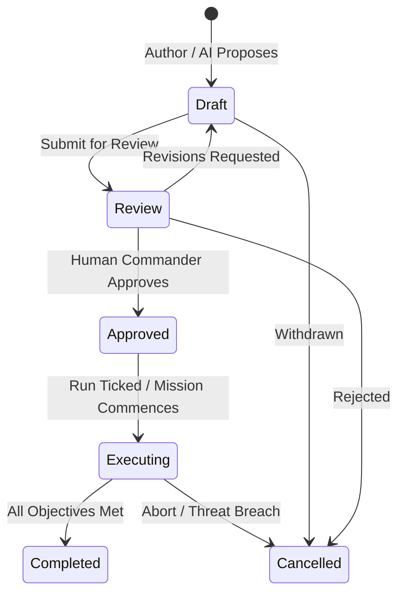

# Mission Planning Subsystem Specification (Phase 2B)

**Owner:** MISSION_ENGINEER Agent (ECC Protocol)  
**Program:** Defense Operations Intelligence Platform (DOIP)  

---

## 1. Lifecycle State Machine



### Safety Guardrails
- **Human Invariant:** Transition to `Approved` or `Executing` requires an authenticated human operator (`role in ['operator', 'planner', 'admin']`).
- **AI Boundary:** The AI Drawer or LLM Assistant can create or edit `Draft` missions, but has ZERO privilege to execute or approve missions.

---

## 2. Entity Model & Data Structures

```python
class MissionStatus(str, Enum):
    DRAFT = "draft"
    REVIEW = "review"
    APPROVED = "approved"
    EXECUTING = "executing"
    COMPLETED = "completed"
    CANCELLED = "cancelled"

class MissionPriority(str, Enum):
    CRITICAL = "critical"
    HIGH = "high"
    ROUTINE = "routine"
    LOW = "low"
```

### Resource & Duration Estimation Engine
1. **Distance Calculation:**
   Sum of haversine distances across ordered mission waypoints:
   $$D_{\text{total}} = \sum_{i=1}^{n-1} \text{Haversine}(W_i, W_{i+1})$$
2. **Duration Estimation:**
   $$\text{Duration} = \frac{D_{\text{total}}}{V_{\text{cruise}}} + \sum_{k} T_{\text{task\_loiter}}(k)$$
3. **Fuel Burn Estimation:**
   $$\text{Fuel} = \text{Duration} \times \text{BurnRate}_{\text{unit}} \times (1.0 + \text{PayloadFactor})$$
4. **Risk Scoring ($0.0$ to $1.0$):**
   Aggregates proximity to known threat zones, active incidents, and severe weather along the route:
   $$\text{Risk} = \min\left(1.0, \, 0.1 \times N_{\text{waypoints}} + 0.3 \times N_{\text{threat\_intersections}} + 0.2 \times N_{\text{weather\_cells}}\right)$$

---

## 3. REST API Contract

- `POST /api/missions`: Create mission (`Draft`).
- `GET /api/missions`: List active and historical missions.
- `GET /api/missions/{id}`: Fetch detailed mission plan with tasks, waypoints, and assigned assets.
- `POST /api/missions/{id}/transition`: State machine transition (`Draft -> Review -> Approved -> ...`).
- `POST /api/missions/ai-draft`: Generate a structured mission draft from natural language prompt (e.g. *"Convoy escort from Base Bravo to Depot 4"*).
